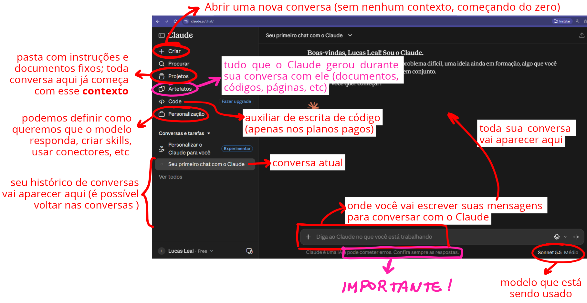
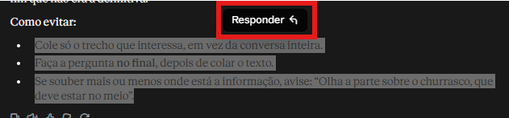
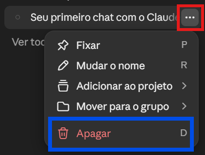

# Onde usar
Pra começar você pode **utilizar diretamente no navegador** em ***claude.ai*** ou baixando o **app para desktop** (inclusive pode usar os 2 e as informações são compartilhadas), fazendo o cadastro com sua conta de e-mail ou direto pelo Google e aceitando os termos.
Ao perguntar sobre os **planos, escolha o Free** que já inclui bastante coisa (algumas questões como Claude Code, modelos mais potentes como Opus / Fable e agendamento de tarefas ficam disponíveis apenas nos modelos pagos mas não são necessários para começar)
Depois ele faz algumas perguntas, responda de acordo com suas preferências (é possível alterar depois em Personalização) e pronto, você já terá a primeira tela do Claude.
# A interface do Claude
Assim que abri-lo, essa será a primeira tela:

E pra entendê-la melhor precisamos relembrar um conceito que está em [[Claude do zero!#LLM]] sobre **janela de contexto**:
- **O modelo só vai saber o que você tiver passado pra ele naquela conversa**, então qualquer informação fora disso vai ser ignorada (se você falou em outra conversa, se é um arquivo que tá no seu computador ou até se é uma informação que ele não foi ensinado)
	- O aplicativo tem uma memória, então algumas coisas básicas que ele "julgar" relevante ele vai lembrar. Como isso é automático e não podemos escolher o que entra, não serve como **contexto** (para isso devemos usar projetos ou anexar arquivos de contexto)
- Importante: **janela tem limite e custo** e é por isso que não vamos sempre enviar tudo (além de gerar outros problemas que podemos falar depois, mas pra quem tiver mais curiosidade *pode pesquisar por lost in the middle, dilução de atenção, contaminação por contexto antigo e principalmente CUSTOS e LATÊNCIA*)
	- Uma sugestão é usar o próprio Claude pra pesquisar isso

Dito isso, vamos considerar o que temos nessa primeira tela, sendo o principal:
- **Criar**: começar um novo chat com o Claude
	- Ele não vai ter **nenhum contexto**, ou seja, não vai saber nada do que você já falou com ele anteriormente (ele só vai ter a memória do app)
	- Vai começar o assunto do zero, se você quiser que ele saiba algo é necessário que você explique pra ele (ou passe um arquivo por exemplo)
- **Projetos**: permite criar grupos de chats, adicionar documentos e definir instruções onde tudo que está dentro desse projeto **terá o mesmo contexto**
	- É possível definir regras, padrões de resposta e adicionar arquivos
- **Personalização**: podemos definir como queremos que o Claude responda, ver / apagar a memória, criar conectores com outras ferramentas como Google, adicionar skills, mudar idioma, privacidade, etc
	- **Skills** são um **conjunto de instruções** que o Claude vai consultar quando precisar realizar alguma tarefa específica
		- Por exemplo, se você precisa validar um mesmo documento todos os dias, você pode criar uma skill com o passo a passo que é feito para realizar a validação
			- Amanhã, quando o mesmo documento chegar, o Claude usa essa skill e já vai ter todos os direcionamentos de como executar a tarefa
		- Diferente de projetos que o contexto sempre vai entrar em toda conversa, a skill fica guardada e o Claude só usa quando percebe que é necessário (também podemos chamar a skill)
		- Várias skills de tarefas mais comuns já estão prontas (como word, excel, pdf) e muitas vezes o Claude usa sem você nem saber (por isso que quando você pede uma planilha ele te entrega um .xlsx bonitinho e não uma tabela em texto) 
- **Conversa atual e histórico de conversas**: é possível voltar em uma conversa e ter várias conversas diferentes sobre diversos tópicos
	- **Como cada conversa vai ter um contexto, vale abrir uma nova conversa para tratar de cada novo assunto** assim o Claude não fica com muito contexto desnecessário e você consegue ser mais assertivo nos tópicos
- Na parte de baixo temos o "**Diga ao Claude no que você está trabalhando**" que é exatamente a região onde iremos manter nosso diálogo com o modelo
	- O "**+**" no canto esquerdo permite anexarmos arquivos, ativar busca na web, gerenciar skills e conectores
		- A busca na web é importante pois o modelo **não possui informações após a data de corte** e qualquer conhecimento após isso precisa vir da web
- No canto inferior direito é possível ver "**Sonnet 5.5 Médio**", que é o modelo e esforço que está sendo usado atualmente nessa conversa
	- Esse é o padrão do Claude Free
	- Existe um **limite de uso do Claude que é definido pelo número de tokens que podem ser usado em um intervalo de tempo** (5 horas) e cada modelo pode consumir mais ou menos tokens
		- Se você chega nesse limite o app te avisa e você espera o reset (não precisa pagar)
	- O Sonnet é um modelo mais potente (tem mais capacidade de "pensamento") que o Haiku (os 2 modelos disponíveis no plano Free), porém consome mais token
	- Também é possível mudar o "**Esforço**" clicando nele (que é basicamente o quanto o modelo "*raciocina*" antes de responder, o que aumenta a capacidade de geração de respostas mais completas e análises mais complexas), porém também consome mais tokens (além de levar mais tempo)
- O **IMPORTANTE!** em rosa deixa um aviso muito claro: **o Claude é um modelo de IA e pode cometer erros!**
	- Você como usuário da ferramenta deve garantir a qualidade da informação que está sendo gerada
	- Da mesma forma que não é responsabilidade do carro se você comete um acidente, não é responsabilidade do Claude se você entrega uma informação errada!
		- IA é meio, não fim!
		- E que bom, pois isso garante o nosso emprego
# Como conversar com o Claude
Antes de falar seu primeiro oi, é preciso entender que o que o Claude faz é rodar um LLM ([[Claude do zero!#LLM]]) e que pra esse tipo de modelo **quanto melhor você for em ter claro o que precisa, conseguir colocar isso em palavras e trazer o contexto: melhor será o resultado que ele vai te entregar!**
É muito normal a gente ver algo do tipo: "ai mas o Claude / ChatGPT não tá sabendo gerar o que eu quero", "ele não consegue me dar o que eu preciso" e na maioria das vezes o grande problema é que muita gente não sabe como usar essas ferramentas (e que a partir de agora não vai ser mais o seu caso)
E o que vai te diferenciar em uma entrevista e até usando qualquer uma dessas "IAs" vai ser exatamente isso, sua capacidade de gerar resultados corretos (conteúdo verdadeiro e conferido, sem alucinação), completos (respondendo ao que foi pedido, sem deixar buracos nem inventar escopo) e adequados a quem vai receber (formato, tom, tamanho)
## Pilares de uma boa conversa
1. **Seja muito claro**: o Claude não vai ter o "bom senso" de entender algo que você não explicitou e nem vai pensar em algo que pra você é "muito óbvio"
	- Se você precisa de um resumo e já sabe que ele precisa ser relacionado aos riscos do negócio, já pede isso pra ele
		- Ao invés de "Resume pra mim" fala: "cria um resumo focado nos riscos pro negócio da nova proposta"
2. **Traga contexto**: lembre-se que ele sempre vai começar do zero, então entregue pra ele todo o contexto que ele vai precisar pra resolver o problema
	- Você pode ter um arquivo com contextos que usa geralmente e mandar junto na conversa ou usar projetos
	- Diga **quem você é, descreva o seu cargo e seu objetivo** com aquela conversa, informe **pra quem você vai entregar o resultado**
		- Ex: "Sou um desenvolvedor e estou fazendo uma documentação do projeto para o time de infraestrutura..."
3. **Dê exemplos**: mostre um material pronto que você já fez, dê referências de materiais da sua área
	- Cole um relatório antigo e peça "gere no mesmo formato", faça um desenho de como você pensou o seu resultado
4. **Não confie cegamente!**: quando ele responder, peça as fontes de onde ele tirou aquilo e confira direto de onde as informações estão vindo
	- Datas, citações, números, nomes de leis e artigos são muito difíceis para o LLM e ele pode errar
5. **Peça o contrário**: naturalmente LLMs têm a **tendência a começarem a te bajular e concordar com você, peça para que ele faça o contrário**, que mostre o que está faltando, argumentos contra, problemas do que está fazendo, crie revisões críticas do seu material
6. **Faça iterações**: depois que ele te responder, você vai analisar a resposta e então começar a explicar pra ele como melhorar (em relação ao que você espera)
	- Veja o que ele falou e responda pedindo mais detalhe, alterando a forma que está respondendo e conversando com ele para **direcionar para o que você precisa**
	- Não espere que ele te responda na primeira mensagem, ela é só o ponto de partida
7. **Defina o tom**: indique qual o formato você espera da resposta (tamanho, tom, idioma, público)
	- Você pode fazer o **role prompting**, que é atribuir um papel ou uma persona, e juntamente dizer qual o objetivo dela (ex: "você é um recrutador sênior de tecnologia e precisa conseguir avaliar o melhor candidato para a vaga X")
# Sua vez!
Muito melhor que ficar criando um artigo enorme para te explicar como usar o Claude é você mesmo colocar a mão na massa e começar a usar a ferramenta.
### O que é lost in the middle?
Lá no início dessa nota eu comentei sobre "*lost in the middle*" mas não expliquei o que era, abre o seu Claude e faça essa pergunta: 
> O que é lost in the middle?

Quando eu fiz isso, a resposta foi:
> “Lost in the middle” é um fenômeno observado em modelos de linguagem (LLMs) em que o desempenho cai quando a informação relevante está no **meio** de um contexto longo, em vez de no começo ou no fim.
> 
> **De onde vem**
> 
> O termo ficou conhecido por um artigo de 2023 (Liu et al., “Lost in the Middle: How Language Models Use Long Contexts”). Os pesquisadores colocaram a resposta de uma pergunta em diferentes posições dentro de um conjunto de documentos e mediram a precisão. O resultado foi uma curva em forma de **U**: os modelos acertavam mais quando a informação estava no início (efeito de primazia) ou no final (efeito de recência), e erravam mais quando ela estava no meio.
> 
> **Por que acontece**
> 
> Não há uma explicação única, mas as hipóteses mais comuns são:
> 
> - **Viés dos dados de treino**: textos naturais costumam concentrar informação importante no começo e no fim.
> - **Mecanismo de atenção e codificação de posição**: a atenção tende a favorecer tokens iniciais e recentes.
> - **Diluição**: quanto mais texto, mais o sinal relevante compete com ruído.
> 
> **Por que importa na prática**
> 
> - Em **RAG** (busca + geração), a ordem dos documentos recuperados influencia a resposta.
> - Em prompts longos, instruções importantes escondidas no meio podem ser ignoradas.
> - Ter uma janela de contexto grande não garante que o modelo use bem tudo o que cabe nela.
> 
> **Como mitigar**
> 
> - Colocar as informações e instruções mais importantes no **início ou no fim** do prompt.
> - Reordenar os documentos recuperados, deixando os mais relevantes nas pontas.
> - Reduzir o contexto: incluir só o necessário, em vez de despejar tudo.
> - Repetir instruções críticas no final do prompt.
> - Dividir tarefas longas em etapas menores.
> 
> Vale notar que modelos mais recentes têm melhorado bastante nesse ponto, e o efeito varia conforme o modelo e a tarefa. Ainda assim, continua sendo uma boa prática posicionar o que é crítico com cuidado.

Observe que ele respondeu muita coisa, inclusive com conceitos que você nunca ouviu falar. Agora mude a sua pergunta para:
> Eu nunca usei o Claude e estou dando meus primeiros passos em IA, você poderia me explicar o que é "Lost in the Middle" de forma simples e bem direta para que eu comece a entender esses conceitos? Não precisa incluir muita explicação, se eu tiver alguma dúvida eu vou te pedir

Nesse caso, a minha resposta já foi bem mais direta:
> “Lost in the Middle” (perdido no meio) é quando uma IA tem dificuldade de lembrar ou usar informações que estão no **meio** de um texto longo.
> 
> Ela presta mais atenção no **começo** e no **fim** do que recebeu, e tende a “esquecer” o que ficou no meio.
> 
> **Analogia:** é como ouvir uma palestra bem longa. Você lembra bem da introdução e da conclusão, mas se perde nos detalhes do meio.
> 
> **Dica prática**: coloque o que é mais importante no início ou no final do seu pedido.

Observe que quanto melhor você consegue pedir pra ele o que você quer, mais adequada será a sua resposta.
É importante entender que em um LLM, para uma mesma pergunta, **a resposta gerada quase nunca será igual**. Isso acontece pois o resultado do modelo é um texto previsto e não um texto decorado.
- Na hora de gerar o token seguinte, ele vai **sortear entre os mais prováveis** e esse sorteio acaba gerando respostas diferentes
Por isso a sua resposta é diferente da minha mas as técnicas usadas pra melhorar aqui também vão funcionar aí.

E você pode continuar a conversa no **mesmo chat** como:
> me dá um exemplo disso no meu dia a dia

Observe que agora **você não precisou trazer todo o contexto** novamente pois ele já tem essa informação do histórico desse mesmo chat. A minha resposta foi:
> Imagine que você cola na IA uma conversa de grupo bem longa (umas 200 mensagens) e pede: “Me diga quando e onde ficou combinado o churrasco.”
> 
> Se a combinação do dia e do local aconteceu **no meio** da conversa, no meio de várias outras mensagens, a IA pode errar, dizer que não encontrou ou pegar uma informação do começo ou do fim que não era a definitiva.
> 
> **Como evitar:**
> - Cole só o trecho que interessa, em vez da conversa inteira.
> - Faça a pergunta **no final**, depois de colar o texto.
> - Se souber mais ou menos onde está a informação, avise: “Olha a parte sobre o churrasco, que deve estar no meio”.

Inclusive, se você selecionar um trecho da conversa você pode perguntar algo especificamente sobre isso, por exemplo eu selecionei esses 3 últimos bullet points, cliquei em responder como mostrado abaixo e fiz a pergunta:

> se eu fizer isso então eu não teria lost in the middle? preciso fazer os 3?

E a resposta:
> Não precisa fazer os 3, e nenhum deles garante 100% que o problema some. Eles só **diminuem a chance** de ele acontecer.
> 
> - **Colar só o trecho que interessa** é o mais eficaz. Com menos texto, quase não existe “meio” para a informação se perder.
> - **Fazer a pergunta no final** ajuda, mas é um complemento.
> - **Avisar onde está a informação** ajuda a IA a procurar no lugar certo, mas é o menos importante dos três.
> 
> Na prática, se você já colar só o trecho relevante, o resto fica quase desnecessário. Os outros dois servem para quando você não consegue reduzir o texto.
> 
> Vale lembrar também que as IAs mais recentes erram menos nisso, então para textos curtos ou médios você provavelmente nem vai notar o problema.

Agora eu questionei uma informação e ele foi mais detalhado no sentido de nada garantir 100% e do que é mais eficaz e do que só ajudaria. 
Repara que na primeira ele apontou os 3 meio que como se fossem iguais, só quando eu questionei que ele contou qual realmente era importante. Por isso **é tão importante pedir o contrário, questionar**

Se você quiser, você pode continuar essa conversa perguntando qualquer coisa que te desperte curiosidade. Só que agora vamos dar um passo além: vamos falar de um problema real que você tenha.

E aqui eu quero te dar outra dica antes da gente seguir: Lembra que eu falei que **tudo que estiver no mesmo chat vai servir de contexto** pra sua conversa?
Se você começar perguntando sobre lost in the middle e depois pedir ajuda para escrever um e-mail naquele mesmo chat, você tá guardando toda a conversa sobre lost in the middle de forma desnecessária e como falamos isso consome tokens (que você tem um limite)
Então **a melhor forma de começar a falar sobre um novo assunto é criando um novo chat** e quando você quiser é só voltar em chats antigos para continuar aquela conversa.

> ***Nossa Lucas, mas aí eu vou ficar com 1 milhão de chats abertos***

Pro Claude isso não é um problema mas se você achar melhor para se organizar você sempre pode **clicar nos 3 pontinhos na frente de cada chat e pedir pra apagar**.

### Problema real
Vamos supor que você está no trabalho e tem um arquivo Excel com todos os dados de clientes da sua empresa e quer pedir ajuda ao Claude para analisar as informações. O que você faria?

Antes de pensar em qualquer coisa: **não faça nada!**

Um dos pontos mais críticos quando falamos de IA sendo usadas no trabalho é o que chamamos de **Shadow AI**, que é quando dados sensíveis de empresas são colocados em ferramentas de IA não homologadas e aprovadas pelas companhias.
Isso é uma das principais portas para **vazamento de dados de empresas** e segundo o relatório da Microsoft, 71% dos funcionários no Reino Unido já usaram ferramentas de IA não aprovadas no trabalho ([fonte](https://ukstories.microsoft.com/features/rise-in-shadow-ai-tools-raising-security-concerns-for-uk/))

Então antes de pensar em colocar qualquer informação na IA, **pense primeiro se o dado que está ali é algo sensível e que não deva ser exposto publicamente!**

> ***Então Lucas, quer dizer que eu não posso usar IA pro meu trabalho?***

E claro que pode, porém ao invés de jogar todo o Excel ali você pode:
- Remover os dados sensíveis e colocar apenas a informação não confidencial na IA
- Trocar os dados sensíveis por valores anonimizados (trocar um nome por uma letra, um CPF por um dígito)
- Explicar pra IA qual é o seu problema e ir pedindo pra ela te ajudar passo a passo na análise
	- A IA sugere o que você deve fazer no Excel, você implementa

E isso é o que mais vai fazer diferença no seu trabalho, se o seu chefe descobre que você está colocando dados da empresa em uma ferramenta de IA ou até se esse dado vazar, o problema pode ser gigante, mas se você está **conversando com uma IA para ela te ajudar a otimizar o seu trabalho**, todo mundo ganha!

Ah, e só pra fechar, quando você perceber que tá **sempre tendo que dizer as mesmas coisas, passar os mesmos contextos ou mandar os mesmos exemplos no chat**, talvez seja a hora de pensar em **criar um projeto** e sempre que precisar de algo novo ir direto no projeto sabendo que tudo que você precisa já vai estar ali!

Agora sim, sabendo disso, pense no problema que você quer resolver e use a IA para te ajudar. **Use a IA também pra aprender coisas novas** e pra cobrir gaps que faltavam pra você conseguir se candidatar pra aquela vaga que você tá esperando faz tempo. Peça pra ela te ensinar e faça do Claude o seu parceiro de estudos (isso me ajuda muito!)

Eu, por exemplo, estou usando IA nesse momento para coisas simples como me ajudar a escrever um e-mail formal até para coisas mais complexas como me ensinar do zero a criar um jogo em Godot (inclusive esse artigo quem me ajudou a revisar foi o Claude)

PS: lembre-se sempre que a IA é ferramenta e serve pra te auxiliar, não pra fazer todo o seu trabalho. Sempre use de maneira ética e respeite o trabalho dos outros!