Link do vídeo: https://youtu.be/LOhfqjmasi0?si=JzgCt9r8iZ8poMSK
Obs: o vídeo foi feito na versão 4.1 da GODOT e hoje (out/26) estamos na versão 4.6 então algumas coisas vão ser diferentes (e vou citar aqui)
Os capítulos abaixo estão separados de acordo com a divisão do vídeo
- GODOT é muito amigável pra quem tá começando, open source e grátis
- dá pra fazer desde jogos 2D até um FPS 3D
# Começando
Para instalar: [[Primeiros Passos#Instalação]]
- é muito fácil de instalar e roda até no browser

Criando um novo projeto: [[Primeiros Passos#Criando um novo projeto]]

Assim que fizermos isso já vai abrir um canvas em branco, que basicamente vai ter os seguintes componentes: [[Primeiros Passos#O editor da GODOT]]

Aqui, nosso objetivo é criar um jogo simples 2D:
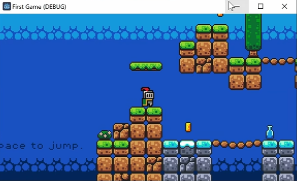
Temos:
- Jogadores
- Inimigos
- Plataformas móveis
- Moedas coletáveis

Para **programação**, GODOT usa sua própria linguagem de programação chamada **GDScript**
- Não precisa se preocupar em entender totalmente os códigos (no próximo vídeo ele fala sobre GDScript)

Para fazer um jogo vamos precisar dos **"ingredientes"** (os assets), como:
- Sprites
- Models
- Textures
- Sounds
Os assets desse jogo estão disponíveis em:
https://brackeysgames.itch.io/brackeys-platformer-bundle
Podemos encontrar assets em vários outros lugares como:
- itch.io
- opengameart.org
- kenney.nl
Se ele for CC0 significa que ele é livre para uso sem precisar dar créditos

Voltando pro canvas, no lado inferior esquerdo temos o **PAINEL DE ARQUIVOS (lista os arquivos do projeto)**
- Por padrão ele começa apenas com o icon.svg (que é o ícone da GODOT)
- Vamos criar 3 novas pastas: assets, scenes e scripts
- Vamos baixar os assets, extrair o zip e arrastar todas as pastas pra essa pasta de assets

# Como a GODOT funciona
Leia mais em: [[Primeiros Passos#Principais conceitos]]
Pra fazer qualquer coisa na GODOT nós vamos usar **nodes**
Então qualquer elemento na GODOT vai ser **um conjunto de nós**, sendo assim o nó vai ser o bloco fundamental do nosso jogo!
Tem vários tipos e cada um tem sua função:
- Sprite: mostrar uma imagem
- Audio: tocar um som
- RigidBody: adicionar física

Em GODOT a gente **não precisa criar tudo do zero**, o nosso trabalho é basicamente **colocar tudo isso junto e organizá-los**

Podemos estender nodes para criar outros nós mais poderosos
Criar um jogo na GODOT é combinar e estender nós!

Para evitar criar um nó dentro de outro dentro de outro até ficar uma coisa super complexa, vamos criar as **cenas** para organizar nosso trabalho
- As cenas vão permitir que a gente agrupe nós em **pacotes reutilizáveis**

Todas as cenas vão ser organizadas de forma a termos uma **árvore de nós**, onde o primeiro nó é chamado de nó raiz

Assim que criarmos o jogo ele já vai aparecer com uma primeira cena, vamos usar ela para criar o nosso personagem.
# Player 1.0
## CharacterBody2D
A base do nosso jogo será feita através da criação de nós, se você não sabe fazer ainda leia: [[Primeiros Passos#Nós]]
Sempre que quisermos **testar como tá ficando**, seguir os passos em [[Primeiros Passos#Botão de teste de execução]]

- Vamos clicar em "**+**" e procurar por "**CharacterBody2D**". Ele será o nosso nó raiz dessa cena!
	- Ao criar não vamos ver nada pq precisamos adicionar as partes gráficas

O próximo passo é adicionar a animação e pra isso vamos precisar ajustar as propriedades no Inspetor, leia: [[Primeiros Passos#Inspetor]]
### AnimatedSprite2D
Vai ser o nó usado para criar uma animação 2D na GODOT
- Primeiramente vamos criar um nó de "**AnimatedSprite2D**"
- Vamos clicar nesse nó e ir no inspetor
- Depois em "**Sprite Frames**", vamos em "Novo" e selecionar "**SpriteFrames**"
- Vai abrir a janela de animação e nela vamos selecionar o ícone em verde de "**Add frames from sprite sheet (Ctrl+Shift+O)**"
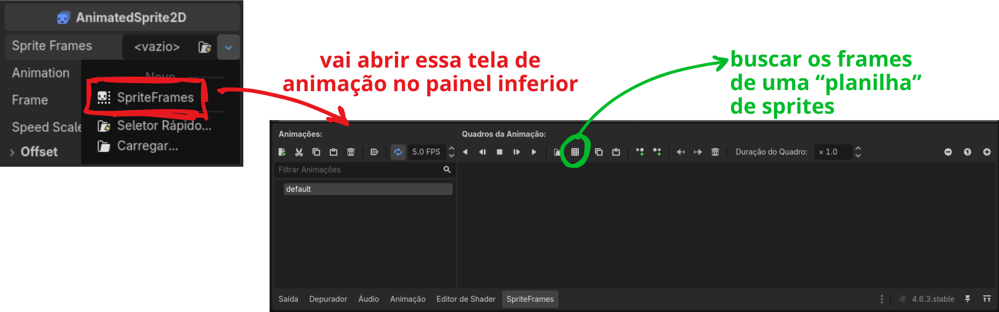

- Na tela que abrir vamos buscar em **assets > sprites** e selecionar o arquivo "**knight.png**".
- Vai abrir essa tela abaixo
	- A gente tem **todos os frames da animação do ator em uma única imagem**: é o que chamamos de **sprite sheet** (é bem eficiente ao invés de precisar criar uma imagem pra cada frame)
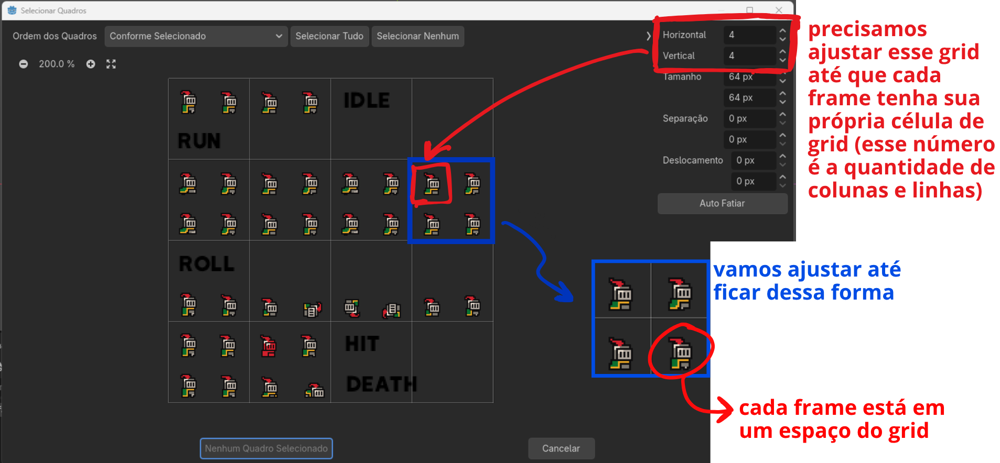
- Nessa tela vamos precisar ajustar as informações de "**Horizontal**" e "**Vertical**"
	- Essa informação é **quantas colunas e linhas** temos na sprite sheet
		- Quando ajustamos esses valores o `Tamanho` já vai sendo ajustado automaticamente
	- Vamos **ajustar até cada frame ficar em uma célula separada** dessa sheet (nesse caso seria 8 x 8)
- Temos ainda mais 3 propriedades
	- `Separação`: define quanto de **espaço** existe **entre os frames**
	- `Deslocamento`: ajusta a imagem quando existe **margem na borda**
	- `Auto Fatiar`: tenta detectar o grid sozinho
- Para **adicionar uma animação** vamos apenas **clicar nos frames na ordem que queremos que eles apareçam nessa animação**
	- Ao clicar no primeiro ele já vai aparecer 0, no seguinte aparece 1 e assim por diante
	- Se quisermos remover basta clicar novamente
	- Para criar a animação de parada (IDLE) podemos clicar nos 4 primeiros sprites e ir em "**Adicionar 4 Quadro(s)**"
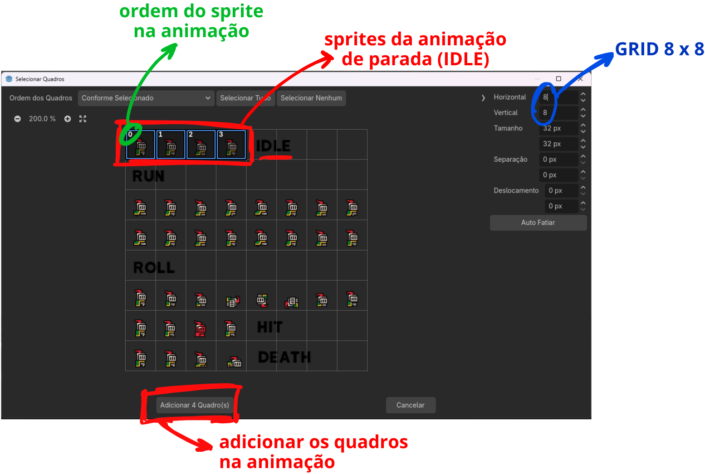
- Nesse momento já vamos ver o nosso Character na tela e podemos usar o **scroll do mouse para aproximar** ou **segurar o botão do scroll para mover** a visualização do editor
Feito isso essa animação já vai ser criada

Agora podemos configurar a animação:
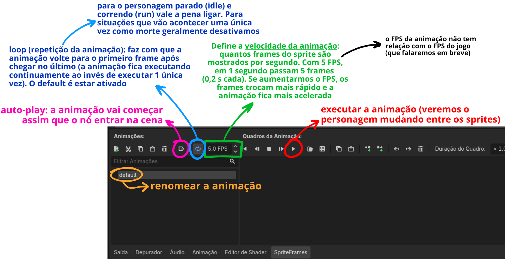
- O botão de **play** em vermelho permite que a gente **execute a animação** (vai ficar trocando entre as imagens)
- No **FPS** vamos definir a **velocidade da animação**
- O botão de **repetição da animação** (em azul) faz com que a animação fique sendo repetida continuamente
	- Quando chega na última imagem da animação, volta pra primeira
	- Vem ativado por padrão
- O **auto-play** faz a animação **começar assim que o nó entra na cena**
	- Se for um nó que já começa no início do jogo, a animação acontece assim que o jogo começa
- Podemos **renomear a animação** clicando 2 vezes no nome dela do lado esquerdo (em laranja)

Para **ajustar o ator na tela**, podemos **clicar com o botão esquerdo do mouse** e **mover esse nó** até a linha de referência (estamos movendo o nó filho e não o nó raiz)

Antes de seguir vamos corrigir um problema rápido do ator parecer meio "borrado"
#### Ator borrado
Ao visualizar o ator no nosso jogo, ele aparece assim:
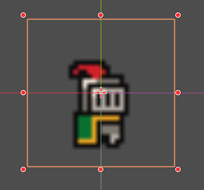

Isso acontece pois é uma pixel art que precisa de bordas bem definidas
Por padrão a Godot vai tentar fazer uma suavização na imagem pra ficar melhor só que isso faz ficar borrado se é pixel art
Para desativar vamos ir em **Projeto > Configurações do Projeto > Renderização > Texturas** e em "**Filtro de Textura Padrão**" vamos mudar para "**Nearest**"
Feito isso, ele fica muito mais nítido:
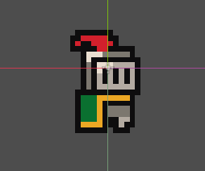

### CollisionShape2D
Feito isso já configuramos boa parte do visual do nosso player, mas ainda temos esse **ícone de alerta** mostrado no nó e ao passar o mouse em cima é exibido uma mensagem dizendo que esse **nó não tem forma** 
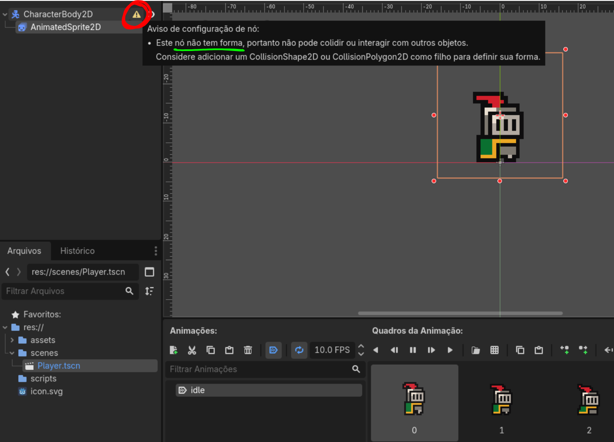

Isso acontece pois o CharacterBody2D é um **nó físico** e sempre que for físico a gente precisa definir um "**shape**" para que a parte física da engine consiga trabalhar com ele (o sprite é só desenho, a engine de física não enxerga pixels, só **shape**)

Para fazer isso vamos adicionar um novo nó de "**CollisionShape2D**" e novamente ir no inspetor
- Vamos **selecionar o Shape que fizer mais sentido** para o personagem e ajustar até ficar dentro da nossa imagem
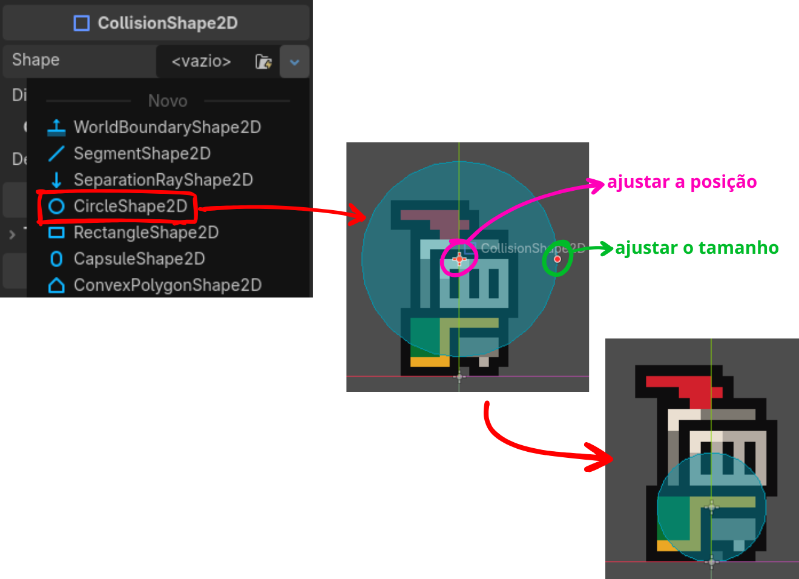

Segundo o próprio Brackeys raramente eles vão precisar ser muito precisos, o que pode ser frustrante é se for muito maior pois vai dar a sensação de que ele tá "encostando" no vazio ou flutuando na tela
## Colocando o jogador no jogo
Para fazer isso vamos precisar de ter o jogador salvo como uma cena que chamaremos de "player" e depois ter uma outra cena ("game") onde iremos ter tanto esse jogador quanto uma câmera para acompanhá-lo

Se não lembra de cenas, leia: [[Primeiros Passos#Cenas]]
Para criar cenas, lembre-se de: [[Primeiros Passos#Cenas abertas]]

Para começar:
- Vamos dar 2 cliques no "**CharacterBody2D**" e trocar o nome para "**Player**"
- Depois "**Ctrl+S**" e salvar a cena como "**player.tscn**"
- Agora vamos criar uma nova cena contendo apenas um "**Node2D**" que vamos renomear para "**Game**" e salvar essa cena como "**game.tscn**"
- **Com a cena "game" aberta, selecionar o arquivo de "player.tscn" e arrastar pro canvas**
	- Com isso o nó do Player já vai ser instanciado (falamos importar quando estamos trazendo assets, para cenas a gente instancia essas cenas) abaixo do nó principal da cena "**game**"
	- 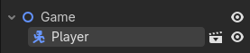
- Podemos ajustar a posição do player simplesmente arrastando ele na tela e aqui estou colocando a origem do player bem na origem dessa cena
	- 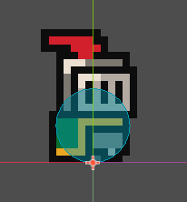

Em seguida vamos criar a câmera que vai acompanhar o player
- Pra conseguir criar o movimento do jogo vamos precisar de uma "câmera" que vai seguindo o jogador
### Camera2D
Primeiramente vamos adicionar o nó de "**Camera2D**" filha do nó **Player** que instanciamos
- Ela precisa ser filha do player para conseguir acompanhar ele
Ao afastar a visão do canvas vamos ter 2 coisas: o enquadramento da câmera (em rosa) e o viewport da janela (em azul)
- Enquadramento: ele começa na origem mas vai se movimentar de acordo com nosso jogo
- Viewport: é fixo na origem e é apenas uma referência mostrando o tamanho da janela (serve apenas para sabermos o que vai caber em uma tela com zoom 1)
	- Se não tiver câmera é exatamente isso que será mostrado
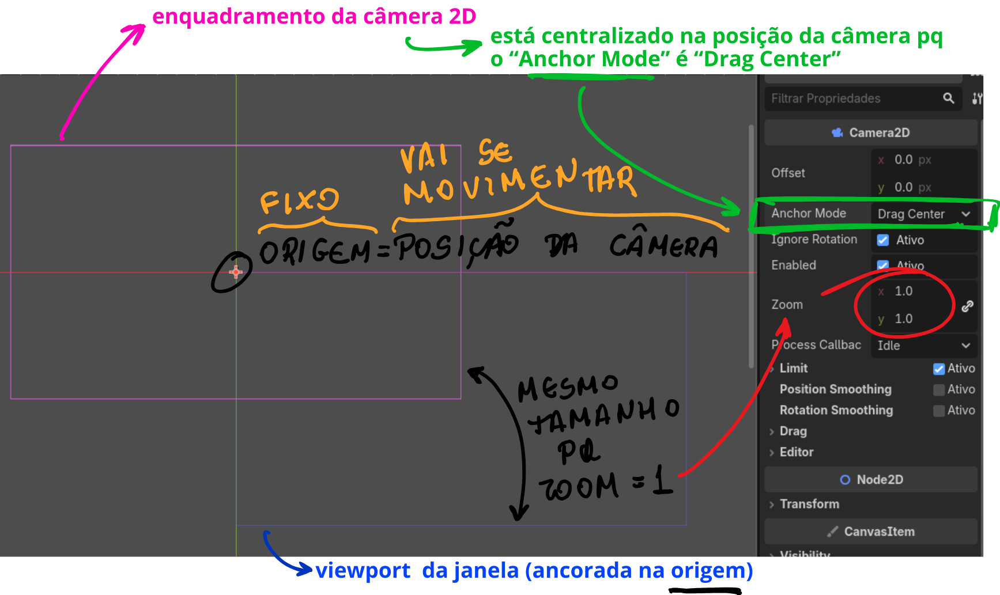

Podemos ajustar a câmera pro zoom que quisermos e aqui vamos usar **zoom = 4** pra ficar maior
Agora quando clicamos em F6 na cena atual já podemos ver o nosso player na tela mas nada acontece pois ainda não criamos o **script** que vai permitir o player se mover
## Criando a movimentação
Agora já temos a câmera mas o jogador ainda está parado e o próximo passo é criar um script que será responsável pelo movimento do player
Para criar scripts, leia: [[Primeiros Passos#Criando scripts]]
Vamos criar **um script no Player**, **ativar o modelo** e colocá-lo na **pasta scripts**

Ao clicar em play o nosso personagem caiu imediatamente pra fora da tela
Isso acontece pois a gente ainda não deu a ele um "chão" para **colidir**

Caso a gente queira mudar a velocidade do player e de salto a gente pode abrir o script e alterar os valores para 130 e -300 por exemplo (só vamos conseguir ver isso sendo aplicado após realizar o passo abaixo)
## StaticBody2D
Para ter algo com o qual **o objeto possa colidir** vamos adicionar um nó de "**StaticBody2D**" na cena game, filho de Game
- vamos usar para coisas que não vão se mover
- Novamente vamos ter o alerta de que ele não tem forma e vamos fazer o mesmo processo que fizemos no [[How to make a Video Game - Godot Beginner Tutorial (Brackeys)#CollisionShape2D]] acima para criar um **CollisionShape2D**
- Dessa vez, no Shape vamos escolher "**WorldBoundaryShape2D**" (que é o shape mais adequado quando queremos lidar com esses limites do nosso mundo no jogo)
	- Ele tem essa forma e se estende infinitamente no eixo horizontal
	- 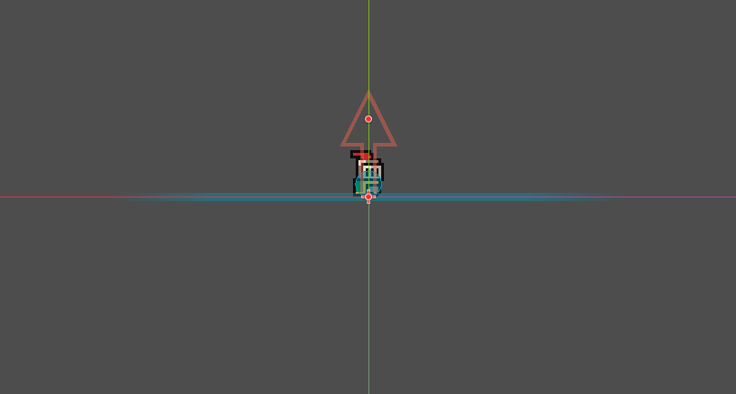
	- Podemos ajustar essa seta vermelha e fazer com que se estenda infinitamente no eixo vertical
		- É apenas em 1 eixo, se quisermos nos 2 eixos precisamos criar 2 objetos desse
Com isso nosso player consegue se mover com as setas e pular com a barra de espaço (caso a gente queira podemos mudar a velocidade de corrida e de pulo como falamos acima)

Com isso fechamos a primeira versão do nosso player!
# Worldbuilding 1.0
O próximo passo é criarmos o nosso mundo e pra isso vamos eliminar o StaticBody2D que criamos acima (fizemos isso só pra ver funcionando) e adicionar um `TileMapLayer`
- No vídeo ele fala de TileMap mas está obsoleto e foi substituído pelo TileMapLayer
	- No TileMap a gente criava várias camadas internas tudo dentro do mesmo nó
	- No TileMapLayer a gente cria **um nó por camada** e coloca a ordem na árvore sendo a ordem de desenho (o de baixo desenha por cima)
## TileMapLayer
A forma mais simples de criar cenários 2D é utilizando TILES ("azulejos") e colocando esses tiles em um grid 2D
- Conseguimos criar vários levels diferentes com apenas poucos tiles
Os tiles são organizados em uma grande imagem com todas as imagens juntas em 1 só em um **TILESET**
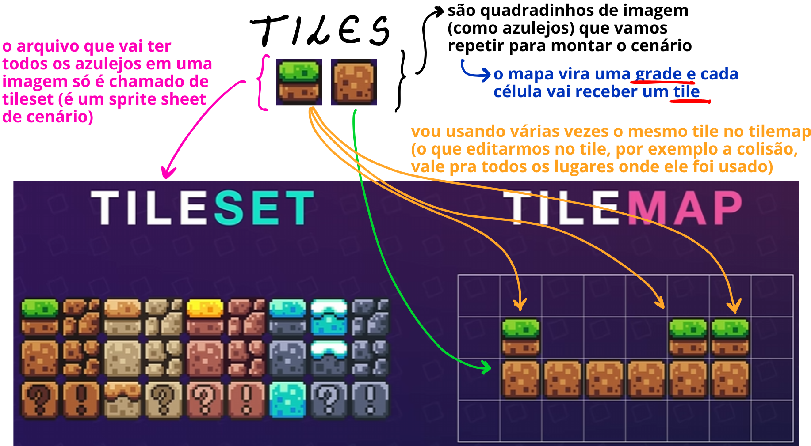
- Obs: existe a imagem do tileset e existe o recurso com o mesmo nome (cuidado pra não confundir)
	- Imagem: é a imagem que vem do arquivo
	- Recurso: é onde vamos configurar nossos tiles

Então vamos adicionar um nó de **TileMapLayer** e **em Tile Set selecionar TileSet**
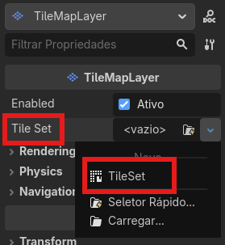

Ao fazermos isso no painel inferior vai aparecer 2 novas abas: **TileMap** e **TileSet**
### TileSet
Para começar vamos selecionar a aba **TileSet** e **arrastar o arquivo do tileset** para a região de "**Fontes de Tiles**"
Ele vai confirmar se queremos criar tiles automaticamente no atlas e podemos clicar em Sim
Ao fazer isso ele automaticamente vai detectar as células que possuem "tiles"
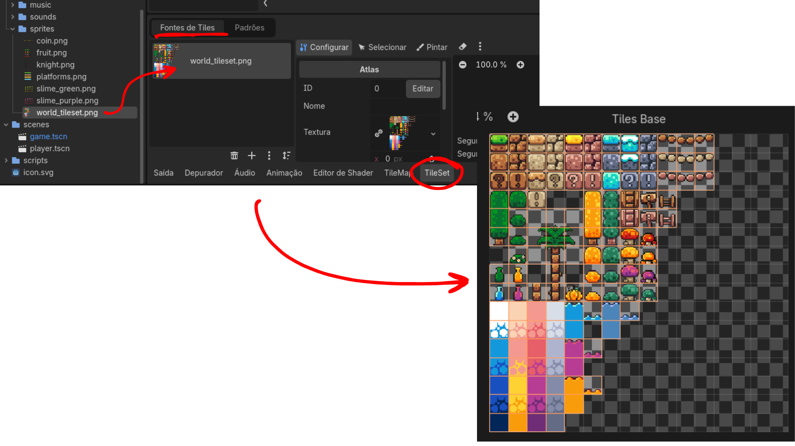
Podemos ajustar usando a **borracha para apagar** e clicando nos tiles que quisermos selecionar (para selecionarmos tiles maiores basta segurar o shift)
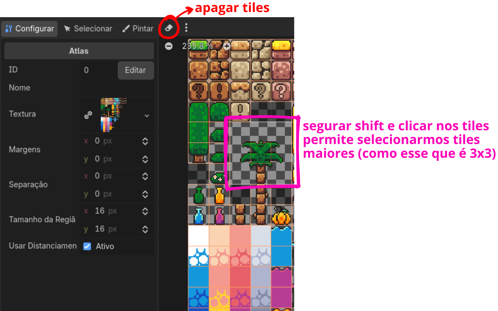

### TileMap
Depois de configurar o TileSet, vamos mudar para a aba TileMap e ao fazermos isso podemos clicar no tile que quisermos, usar a ferramenta de pintura e ir montando todo o nosso cenário
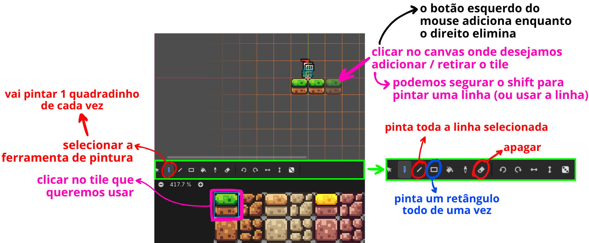
- Se segurarmos o shift e ir clicando em um grupo de tiles podemos selecioná-los juntos (como o caso da ponte, basta segurar o shift, clicar em cada pedaço da ponte e depois levar pro canvas que ela vai junto)
- Podemos usar a seta para selecionar um grupo de tiles (para mover, por exemplo)

Podemos montar o level sendo algo da seguinte forma:
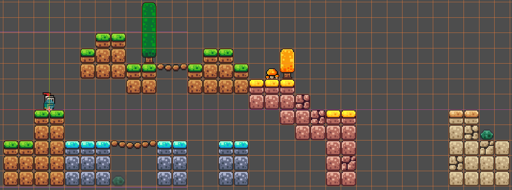
- Observe que a gente consegue fazer a árvore do tamanho que a gente quiser "montando" os tiles

### Physics Layers
Agora que temos nosso cenário, vamos precisar **adicionar física a ele**, para isso vamos **clicar no TileSet nas propriedades do TileMapLayer** e em **Physics Layers** selecionar "**+ Adicionar Elemento**"
Depois vamos novamente em **TileSet**, clicar em "**Pintar**" e no **seletor de propriedades** escolher, dentro de **Física**, a opção "**Camada de Física 0**"
Agora para aplicar essa física nos tiles, basta ir **clicando em cada um deles** onde queremos que isso ocorra
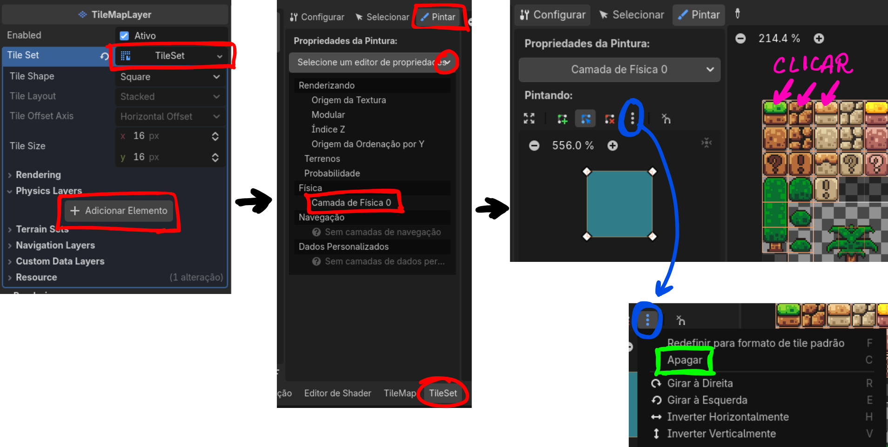
Podem ter alguns tiles onde não queremos que a física ocorra no tile inteiro, então pra isso a gente pode **ajustar esses losangos mostrados em rosa** movimentando de acordo com a imagem que temos no tile.
Além disso, podemos criar novos pontos (vértices) **clicando em qualquer lugar do perímetro dessa região azul** para conseguir detalhar melhor
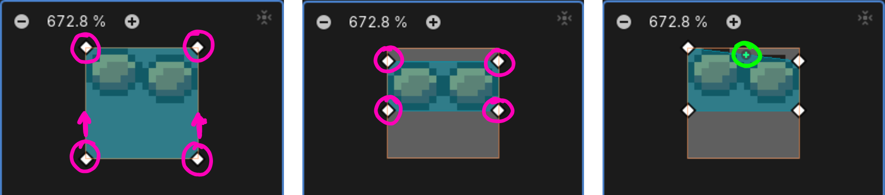
Depois que fizermos esse ajuste, **essa será a nova área de colisão**, então podemos clicar em todos os tiles que queremos que tenha essa mesma região.
Se precisarmos "pegar" a área de algum tile que criamos podemos **usar o conta gotas** que fica ao lado do "Pintar"
Para voltar ao formato padrão, é só clicar em "**Redefinir para formato de tile padrão**" acima do "Apagar" que vimos anteriormente
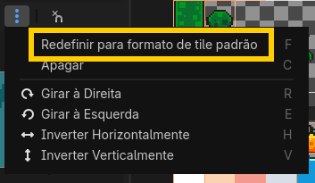