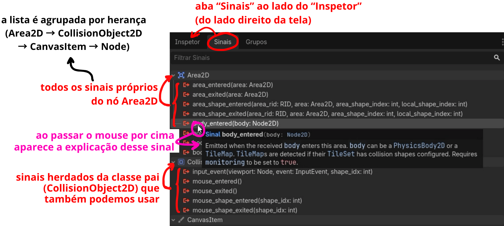
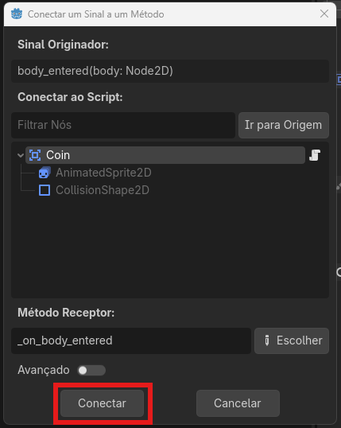

# Conceitos básicos
O nosso jogo tem alguns momentos importantes que definem a execução do nosso script, como
### `_ready`
- É **chamada assim que o nosso nó entra na árvore de cenas**
	- Se o nó está no início do jogo, é chamado no início do jogo
	- Se o nó entra depois na cena (é um elemento que vai surgir durante o jogo), quando esse nó entrar na cena ele vai ser chamado
### `_process`
- É **chamado a cada frame do jogo**
### Sinais
Permitem que a gente **execute códigos baseado em eventos que ocorreram** no nosso jogo (por exemplo, quando o jogador entra na área de "morte" do jogo)
A GODOT já possui muitos sinais integrados e **cada nó vai ter seus sinais específicos**, que **podem ser vistos na aba "Sinais" que fica ao lado do "Inspetor"**
Ao passar o mouse por cima é possível ver a explicação de cada um dos sinais

Para usar um dos sinais, basta dar 2 cliques em cima dele e nessa tela abaixo clicar em "**Conectar**"

Ao fazer isso esse sinal já vai aparecer no nosso código como uma função junto de uma seta verde (no lado esquerdo) indicando que ele está conectado por um sinal.
# Comandos
- `print`: imprimir uma mensagem na "Saída"
- `queue_free`: deleta o nó ao final do frame atual (todos os filhos também são deletados e qualquer referência ao nó ou aos filhos se tornam inválidas)