# n8n auto-hospedado
## Instalação
A própria documentação do n8n sugere algumas [opções de instalação](https://docs.n8n.io/deploy/host-n8n/install-options), sendo a mais simples delas a ["**Configuração de uma linha**"](https://docs.n8n.io/deploy/host-n8n/install-options/one-line-setup). É importante considerar que para essa instalação é necessário que sua máquina tenha disponível 4GB de RAM e 2vCPUs.
Vamos fazer juntos passo a passo a instalação. Se você utiliza Windows siga todos os passos mas caso esteja em um Mac ou Linux pode pular os passos 1 e 3 (por mais que sejam muitos passos, eu juro que é bem mais simples do que parece).

⚠️ É importante avisar que esse instalador é **pra uso local** e **não deve ser exposto na internet!** (isso representa **risco de segurança!**) ⚠️
### 1. Instalar o WSL
**O comando de instalação do n8n é um script de Linux**, então precisamos que exista um Linux na nossa máquina para que ele seja executado. 
O **WSL (Windows Subsystem for Linux, ou Subsistema do Windows para Linux)** é um recurso oficial da Microsoft que **permite rodar o Linux (Ubuntu) de verdade dentro do Windows**, sem precisar formatar o computador ou criar uma máquina virtual manualmente. 
Depois de instalado, aparece um **aplicativo chamado “Ubuntu” no menu Iniciar**. Ele abre uma janela de terminal onde vamos executar os comandos Linux enquanto o resto do Windows continua exatamente igual.

**Como instalar:**
- Abra o **PowerShell** como **administrador** 
	- Pesquise por PowerShell no "Pesquisar", clique com o botão direito em cima dele e selecione "**Executar como administrador**". Confirme no pop up que abrir
- Digite `wsl --install` e dê enter
- Pode ser que ele peça para reiniciar, caso faça isso reinicie o computador e abra o aplicativo do Ubuntu para continuar
- Em seguida, ele vai pedir para criar um **usuário**, escolha o que achar melhor e dê enter
- Depois escolha uma **senha** e novamente dê enter, **repita a senha** e enter novamente
	- Obs: não existe um feedback visual que a senha está sendo digitada (não aparece *** nem nada), porém pode digitar e apertar enter que vai funcionar
- Por fim, ele vai perguntar se você quer enviar relatórios de usabilidade pro Ubuntu e você pode escolher o que achar melhor (isso não impacta em nada a instalação do n8n)
	- Escolha **"y"** para sim, **"n"** para não e **"e"** para ver um exemplo do relatório
- Feitos todos esses passos, o WSL já foi instalado e você já pode fechar essa janela
	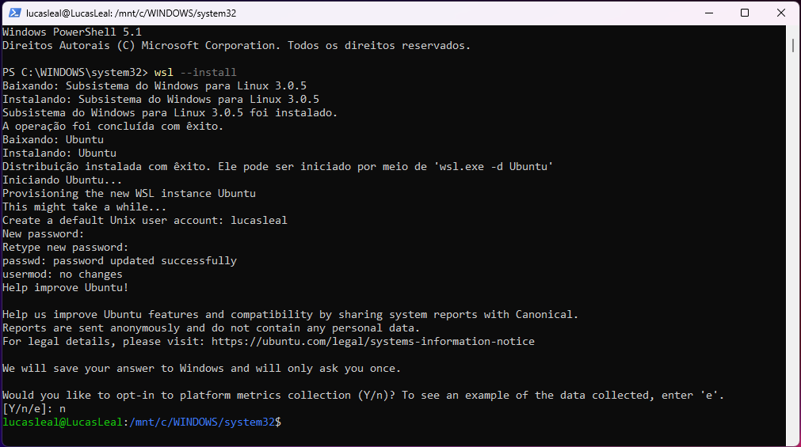
- E o aplicativo do Ubuntu já está disponível no seu computador
	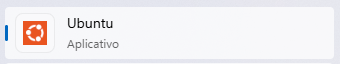

### 2. Instalar o Docker Desktop
As versões mais atuais do n8n **só são distribuídas em containers Docker**.
Um **container** é similar a um container de navio, uma **caixa fechada onde tudo que você precisa para executar o seu programa está ali dentro**. Com isso, não é necessário ficar fazendo várias instalações para começar a usar.
O **Docker** vai ser responsável por **executar o programa dentro dessa caixa** (nada é instalado fora dela). Assim ele consegue manter tudo em um **mesmo local** (evitando que fique espalhado pela máquina), garantir que tudo já está com as **versões corretas** e tornar os programas **fáceis de remover** (é só apagar o container).
Uma observação: nem todo programa em container exige abrir o terminal do Linux, como vamos fazer aqui. Isso é uma particularidade do instalador do n8n, que é um script feito para Linux.
É importante considerar que o **Docker** exige uma subscrição paga se o uso for em empresas com mais de 250 funcionários ou 10 milhões de dólares de faturamento anual, mas isso também não impacta nosso uso no momento.

**Como instalar:**
- Baixe o instalador em https://docs.docker.com/get-started/get-docker/
- Selecione "**Docker Desktop for Windows**" (ou a versão do seu sistema) e clique no "**Docker Desktop for Windows - x86_64**" (ou a sua versão)
- Procure pelo arquivo executável que foi baixado na sua pasta de Downloads e dê 2 cliques nele
- Selecione "**Per-user installation**" e "**WSL 2**" e então dê "**OK**"
	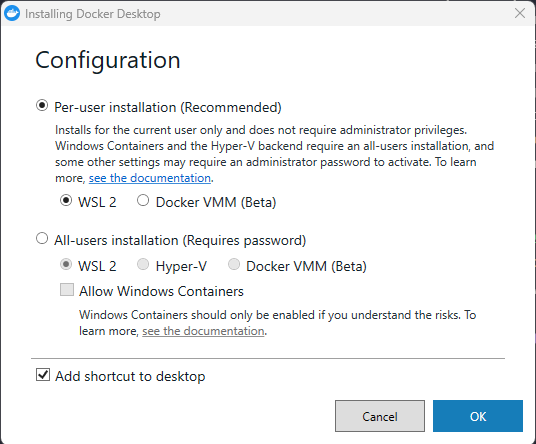
- Ele irá abrir uma nova janela de instalação e quando ela for finalizada é só apertar em "**Close**" que tudo já vai estar instalado
- Feito isso abra o **Docker Desktop**, clique em "**Accept**" na primeira tela que aparecer e na tela de login pode clicar em "**skip**" (não precisa criar conta agora, se quiser você poderá fazer isso depois)
### 3. Ligar o Docker ao Ubuntu
Por padrão o Ubuntu não enxerga o Docker que instalamos no Windows, então essa opção vai disponibilizar o comando `docker` dentro dele, que vai servir pro instalador do n8n conseguir usá-lo.

**Como fazer:**
- Abra o **Docker Desktop**
- Clique em "**Settings**"
- No menu da direita, procure por "**WSL integration**" se estiver na nova versão ou por "**Resources > WSL integration**" se usar a versão clássica
- Ative o "**Enable integration with my default WSL distro**"
- Em "**Enable integration with additional distros**" selecione "**Ubuntu**"
- Clique em "**Apply & Restart Engine**"
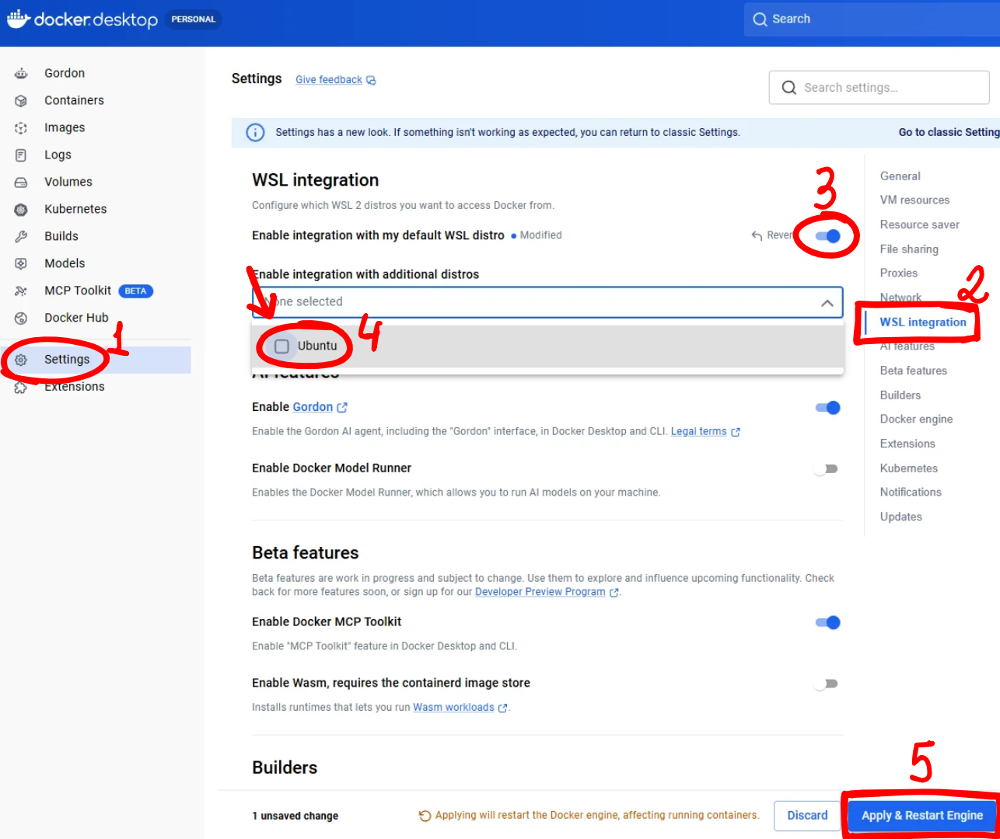

**Conferir:**
Para garantir que tudo está funcionando corretamente, siga os passos:
- Abra o app "**Ubuntu**"
- Execute `docker compose version`
	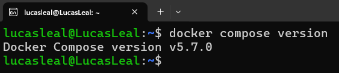
- Se a resposta for:
	- “Docker Compose version” seguido de um número: **OK!**
	- "Command not found": **ERRO NA INSTALAÇÃO**
		- Revise os passos 1 a 3 para verificar se o aplicativo do Ubuntu e Docker Desktop estão instalados e se a configuração foi feita corretamente

### 4. Rodar o one-line setup
Esse é o **instalador oficial** que vai criar a pasta do n8n e gerar todos os arquivos de configuração e assets necessários para rodarmos o programa
Com o **Docker Desktop aberto**, **abra o Ubuntu** e nele execute `cd ~` para ir para a pasta inicial do seu usuário (home) e então  `curl -fsSL https://get.n8n.io | sh` para realizar a instalação
- O curl vai baixar um script da internet e executar na hora, com as permissões do seu usuário, sem vermos o conteúdo. Como o endereço é o oficial do n8n, o mesmo da documentação, isso não é um perigo nesse caso (mas sempre confira antes de rodar um curl).
- Caso queira conferir o script antes, pode fazer em etapas:
	- `curl -fsSL https://get.n8n.io -o get-n8n.sh` (baixa o arquivo)
	- `less get-n8n.sh` (abre o arquivo para leitura)
		- Aperte `q` para sair da leitura
	- `sh get-n8n.sh` (executa)

A execução pode demorar alguns minutos e vai terminar com "**All set!**" como mostrado abaixo:
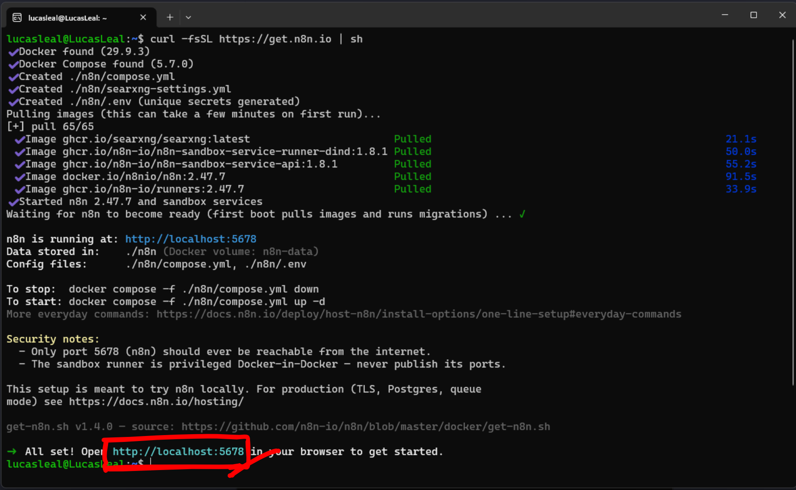

Com isso, o n8n já está disponível em `http://localhost:5678`!
### 5. Abrir o n8n
No seu navegador (Chrome, Edge, etc), digite `http://localhost:5678` na barra de endereços e ele já vai abrir o n8n
Faça seu cadastro com e-mail, nome e senha e clique em "**Next**"
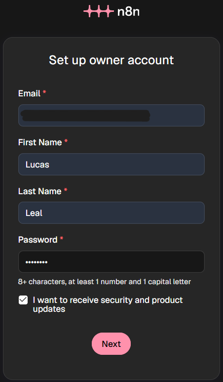

Obs: esse cadastro é uma conta local, guardada apenas na sua máquina (não está no servidor do n8n)

Preencha as informações de acordo com você e sua empresa e clique em "**Get started**", se você não estiver em uma empresa na primeira opção escolha "**I'm not using n8n for work**"
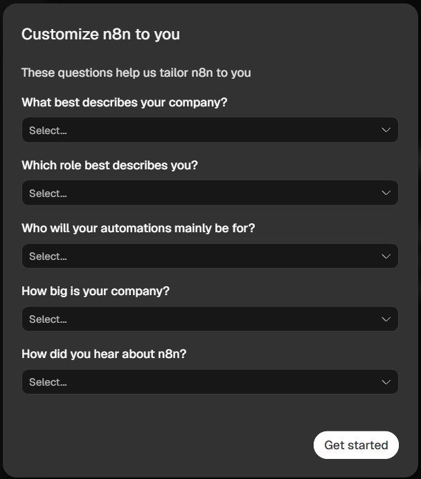

Pode ser que o n8n esteja oferecendo algumas features grátis e caso você deseje receber uma chave de licença basta colocar o seu e-mail e então clicar em "**Send me a free license key**". Caso não queira receber, basta clicar em "**Skip**"
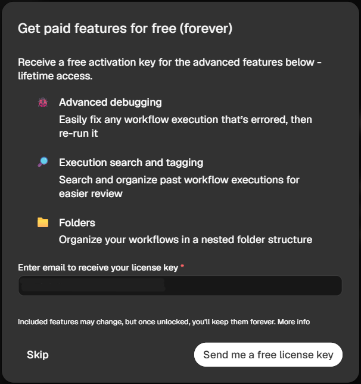

Com isso, seu n8n já está instalado e para abrir um novo fluxo basta clicar no "**+**" e em "**New workflow**"
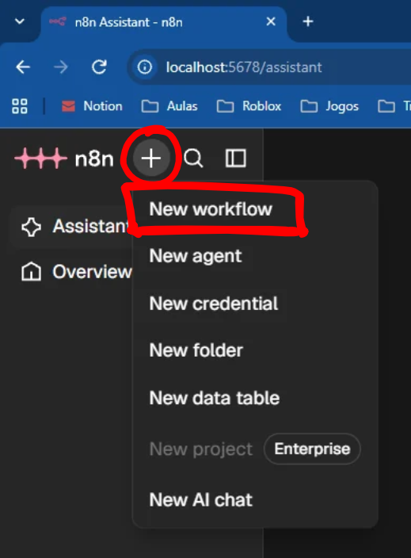
## Usando o n8n
Sempre que você precisar utilizar o n8n,  **abra o Docker Desktop** e espere que o engine fique ativo (no canto inferior esquerdo do Docker Desktop vai aparecer "**Engine running**")
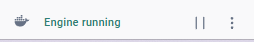
Depois disso acesse `http://localhost:5678` no navegador. É provável que ele já esteja no ar.

Caso isso não aconteça automaticamente, ainda com o Docker Desktop aberto, dentro do **Ubuntu você irá executar os comandos** `cd ~ && docker compose -f ./n8n/compose.yml up -d`

Para **parar o n8n** é possível utilizar `cd ~ && docker compose -f ./n8n/compose.yml down` e para **atualizar** `cd ~ && curl -fsSL https://get.n8n.io | sh -s -- --upgrade`
### Erros conhecidos
- **"Cannot connect to the Docker daemon"**: o Docker Desktop está fechado.
- **Computador muito lento depois de subir**: os containers do n8n estão disputando memória. Pare com o comando acima quando não estiver usando.
- **"command not found"**: o Ubuntu não está enxergando o Docker. Confira se a integração do passo 3 foi ativada e salva, depois feche e abra o Ubuntu de novo.